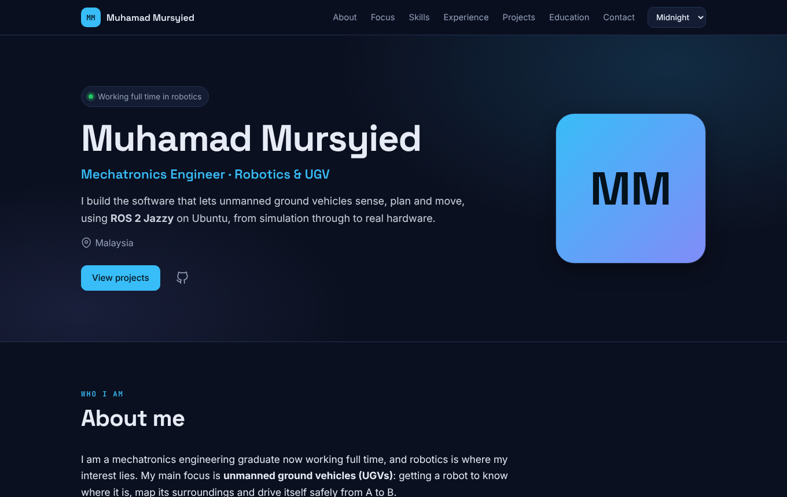
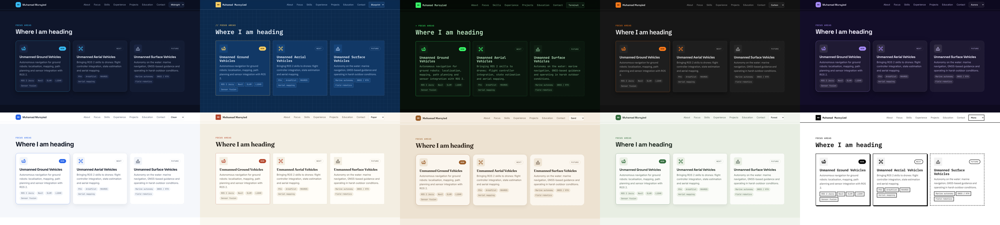
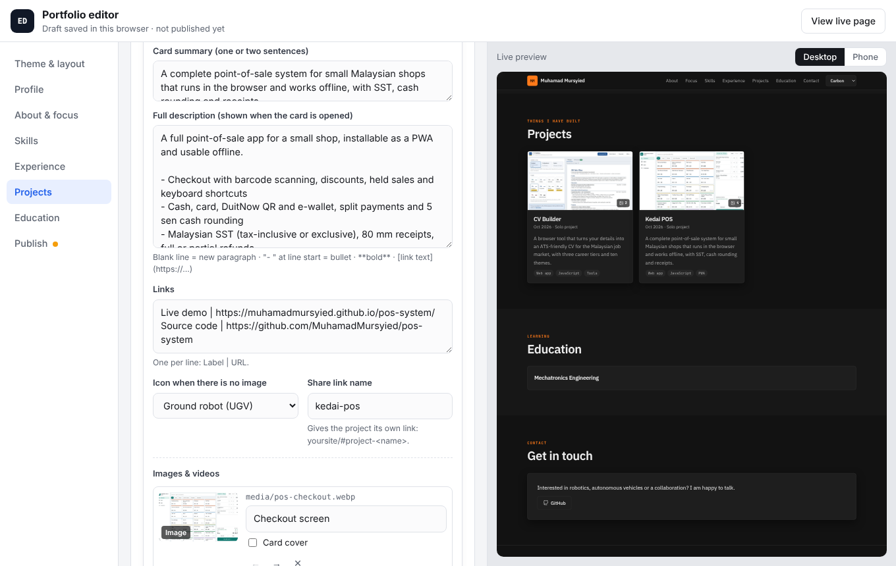

# Portfolio

My personal portfolio site, plus the in-browser editor I use to keep it up to date. Projects, work experience, skills and education live in one content file; the editor lets me change them, add images and videos, switch between ten themes and publish straight to GitHub Pages. No build step, no backend, and no dependencies apart from pdf.js, which is bundled and only loads when you import a PDF CV.

**Live site:** https://muhamadmursyied.github.io/portfolio/  
**Editor:** https://muhamadmursyied.github.io/portfolio/editor.html



## Features

**The site**
- Sections for About, Focus areas, Skills, Experience, Projects, Education & certifications, and Contact. Reorder or hide any of them; empty sections hide themselves.
- A **focus roadmap** (Now / Next / Future) to show where I am heading: UGVs today, UAVs and USVs next.
- **Projects** with a cover image, tag filter and a detail view with a media gallery: images, self-hosted videos (MP4/WebM) and YouTube embeds. Every project has its own share link (`#project-<name>`).
- **Ten themes**: Midnight, Blueprint, Terminal, Carbon, Aurora, Clean, Paper, Sand, Forest and Mono. Visitors can try other themes from the top bar (optional).
- Responsive down to small phones, keyboard friendly, respects reduced-motion settings.

**The editor** (`editor.html`)
- Form for every section with a **live preview** at desktop or phone width.
- **Fill in from your CV**: upload a PDF, Word (.docx) or [CV Builder](https://github.com/MuhamadMursyied/cv-builder) save file and the editor reads your name, contact links, summary, experience, education, skills, projects and certifications. You tick what to use before anything changes, and a PDF can also become the site's "Résumé" download.
- Upload photos and videos from your computer or phone. Large photos are resized in the browser (a 4 MB phone photo becomes roughly 300 KB) before they are stored.
- Autosaves a draft in the browser, so a refresh never loses work.
- **Publish to GitHub** in one click with a fine-grained token, or download `portfolio.js` and upload it on github.com yourself.
- Hidden items: keep a half-written project in the draft without showing it on the site.



## Updating the portfolio

1. Open the editor: https://muhamadmursyied.github.io/portfolio/editor.html (or `editor.html` locally).
2. Optional: on the Profile tab, click **Upload my CV** to fill most fields at once.
3. Edit your profile, add a project, upload screenshots or paste a YouTube link. The preview on the right updates as you type.
4. Go to **Publish**:
   - **Publish to GitHub**: paste a token once (see below) and click Publish. The new files and the content are committed to the repo, and GitHub Pages updates the live site in a minute or two.
   - **Or upload yourself**: download `portfolio.js` (and any new media files), then on github.com upload `portfolio.js` into `data/` and the media files into `media/`.



### Creating the GitHub token

The editor talks to the GitHub API from your browser, so it needs a token that can write to this one repo:

1. GitHub → Settings → Developer settings → **Fine-grained tokens** → Generate new token ([direct link](https://github.com/settings/personal-access-tokens/new)).
2. Repository access: **Only select repositories**, pick this repo.
3. Repository permissions: **Contents → Read and write**. Nothing else.

The token is only sent to `api.github.com`. Tick "Remember the token" only on your own computer; otherwise it is forgotten when you close the tab. The editor page itself is public but harmless without a token.

## Editing the content by hand

Everything shown on the site comes from [`data/portfolio.js`](data/portfolio.js). It is a JavaScript file (so the site also works when opened straight from disk) that holds one JSON object:

```js
window.PORTFOLIO = {
  "site":    { "theme": "midnight", "sections": ["about", "focus", "skills", ...] },
  "profile": { "name": "...", "headline": "...", "links": [{ "label": "GitHub", "url": "..." }] },
  "about": "Paragraphs separated by a blank line. **bold** and [links](https://...) work.",
  "focus":       [{ "title": "...", "stage": "now | next | future", "icon": "ugv | uav | usv | arm | chip | code" }],
  "skills":      [{ "group": "Robotics", "items": [{ "name": "ROS 2", "level": 4 }] }],
  "experience":  [{ "role": "...", "org": "...", "start": "2025-07", "current": true, "highlights": [] }],
  "projects":    [{ "title": "...", "tags": [], "media": [{ "type": "image | video | youtube", "src": "media/x.webp" }] }],
  "education":   [{ "qualification": "...", "school": "...", "end": "2025" }],
  "certifications": [{ "name": "...", "issuer": "...", "url": "..." }]
};
```

Any entry can have `"hidden": true`. Projects can have `"featured": true` and one media item can be `"cover": true`. Dates are `YYYY-MM` or `YYYY`.

## Run it locally

```bash
git clone https://github.com/MuhamadMursyied/portfolio.git
cd portfolio

python3 -m http.server 8000
# site:   http://localhost:8000
# editor: http://localhost:8000/editor.html
```

Opening `index.html` directly from disk also works.

Run the unit tests (Node 18 or newer):

```bash
node --test
```

## Deploy on GitHub Pages

1. Push the files to a repo (named `<username>.github.io` for the root address, or anything else for `<username>.github.io/<repo>/`).
2. Settings → Pages → Build and deployment → Source: **Deploy from a branch**, branch `main`, folder `/ (root)`.
3. In the editor's Publish tab, set the same username, repo and branch.

## Project structure

```
index.html            the public site
editor.html           the editor (not indexed by search engines)
data/portfolio.js     all content
media/                images and videos used by the content
css/themes.css        the ten themes (CSS variables only)
css/site.css          site layout
css/editor.css        editor layout
js/data.js            shared helpers: defaults, dates, safe URLs, YouTube links, content file I/O
js/render.js          builds the page from the content (DOM only, no innerHTML for content)
js/site.js            starts the site, theme switcher, live-preview listener
js/themes.js          theme list
js/icons.js           inline SVG icons
js/editor.js          editor forms, draft, preview
js/media-store.js     local file storage (IndexedDB) and photo resizing
js/publish.js         download and GitHub API publishing
js/cv-import.js       CV reader: PDF (via pdf.js), .docx (built-in unzip), CV Builder .json
vendor/pdfjs/         pdf.js 3.11.174 (Apache-2.0), loaded only when a PDF CV is imported
tests/                unit tests (node --test)
```

**Adding a theme:** add a `[data-theme='name']` block to `css/themes.css` with the same variables as the others, and one line to `js/themes.js`.

## Design notes

- **Plain HTML, CSS and JavaScript.** A portfolio should load fast and keep working for years without dependency updates. The only external resource is Google Fonts, and the site falls back to system fonts without it.
- **Content as a script file, not fetched JSON.** `fetch()` does not work from `file://`, a `<script>` tag does, so the site can be opened locally with no server.
- **Safe rendering.** All content is inserted with `textContent`, and links pass through a check that blocks `javascript:` and similar URLs.
- **CV import is a best guess, then a review.** It finds the usual section headings (Experience, Education, Skills, also common Malay month names) and date ranges, then shows everything it found with tick boxes. Scanned PDFs (pictures of text) cannot be read.
- **One commit per file** when publishing, using the GitHub Contents API. Media is uploaded before the content file, so the live site never references a file that is not there yet.

## Credits

General icons from [Feather](https://feathericons.com/) (MIT). Robot icons drawn for this project. PDF text extraction by [pdf.js](https://mozilla.github.io/pdf.js/) (Apache-2.0, see `vendor/pdfjs/LICENSE`).

## License

[MIT](LICENSE) © 2026 Muhamad Mursyied
